# SiteAdam — архитектура расчёта и нормативных данных

```mermaid
classDiagram
direction LR

class CentrifugalPumpController {
    <<MVC Controller>>
    +Index()
    +Calculate()
    +Calculate(model)
}

class CentrifugalPumpModel {
    <<Model>>
    +Name
    +SelectedSeriesId
    +SelectedNormativeSetId
    +Impeller
    +Volume
    +Weight
    +Number
    +CostHour
    +HourImpeller
    +HourVolume
    +HourWeight
    +TotalSumHour
    +TotalSumCostHour
    +IsCalculated
}

class CentrifugalPumpService {
    <<Calculation Service>>
    +GetSeriesOptionsAsync()
    +GetNormativeSetOptionsAsync()
    +CalculateClosestHoursAsync()
}

class CentrifugalPumpHistoryController {
    <<MVC Controller>>
    +Save()
    +Index()
    +Delete()
    +DeleteAll()
}

class CentrifugalPumpHistoryService {
    <<History Service>>
    +GetAllAsync()
    +SaveAsync()
    +DeleteAsync()
    +DeleteAllAsync()
}

class CentrifugalPumpImportController {
    <<MVC Controller>>
    +Index()
    +Upload()
    +UploadFromServer()
}

class CentrifugalPumpExcelImportService {
    <<Import Service>>
    +ImportAsync()
}

class CentrifugalPumpExcelPage {
    <<Blazor Excel UI>>
    +LoadData()
    +SetColumnWidths()
    +SaveExcelToFolder()
    +DownloadExcelAsync()
    +SaveContractExcel()
    +DownloadContractAsync()
    -BuildContractFromSpreadsheetAsync()
}

class AppDbContextCentrifugalPump {
    <<EF Core DbContext>>
}

class PumpNormativeSet {
    <<Entity>>
    +Id
    +Name
    +FileName
    +CreatedAt
}

class PumpSeries {
    <<Entity>>
    +Id
    +Name
}

class PumpImpeller {
    <<Entity>>
    +PumpSeriesId
    +PumpNormativeSetId
    +Impeller
    +Hour
}

class PumpWeight {
    <<Entity>>
    +PumpSeriesId
    +PumpNormativeSetId
    +Weight
    +Hour
}

class PumpVolume {
    <<Entity>>
    +PumpSeriesId
    +PumpNormativeSetId
    +Volume
    +Hour
}

class PumpCentrifugalHistory {
    <<Entity>>
    +Name
    +SelectedSeriesId
    +PumpNormativeSetId
    +NormativeSetName
    +Number
    +CostHour
    +TotalSumHour
    +TotalSumCostHour
    +CreatedAt
}

class ExcelDataReader {
    <<Excel Import>>
}

class SyncfusionSpreadsheet {
    <<Spreadsheet UI>>
}

class ClosedXML {
    <<Excel Generation>>
}

class ExcelNormativeFiles {
    <<Input>>
    CollectCentrPumps_A.xlsx
    CollectCentrPumps_B.xlsx
    CollectCentrPumps_C.xlsx
}

class ExcelDocument {
    <<Output>>
    XLSX
}

CentrifugalPumpController --> CentrifugalPumpModel : получает данные формы
CentrifugalPumpController --> CentrifugalPumpService : выполняет расчёт

CentrifugalPumpService --> AppDbContextCentrifugalPump : читает нормативы
CentrifugalPumpService --> PumpImpeller : ближайшее значение
CentrifugalPumpService --> PumpWeight : ближайшее значение
CentrifugalPumpService --> PumpVolume : ближайшее значение
CentrifugalPumpService --> PumpNormativeSet : выбранный набор

CentrifugalPumpHistoryController --> CentrifugalPumpHistoryService : управляет историей
CentrifugalPumpHistoryService --> AppDbContextCentrifugalPump : сохраняет и читает
CentrifugalPumpHistoryService --> PumpCentrifugalHistory : создаёт запись
PumpCentrifugalHistory --> PumpNormativeSet : сохраняет нормативный набор

CentrifugalPumpImportController --> CentrifugalPumpExcelImportService : импортирует Excel
ExcelNormativeFiles --> CentrifugalPumpImportController : файл с ПК или сервера
CentrifugalPumpExcelImportService --> ExcelDataReader : читает Excel
CentrifugalPumpExcelImportService --> AppDbContextCentrifugalPump : сохраняет данные
CentrifugalPumpExcelImportService --> PumpNormativeSet : создаёт набор
CentrifugalPumpExcelImportService --> PumpSeries : создаёт или находит серию
CentrifugalPumpExcelImportService --> PumpImpeller : импортирует
CentrifugalPumpExcelImportService --> PumpWeight : импортирует
CentrifugalPumpExcelImportService --> PumpVolume : импортирует

CentrifugalPumpExcelPage --> CentrifugalPumpHistoryService : получает историю
CentrifugalPumpExcelPage --> SyncfusionSpreadsheet : отображает и редактирует
CentrifugalPumpExcelPage --> ClosedXML : формирует контракт

SyncfusionSpreadsheet --> ExcelDocument : сохраняет текущую таблицу
ClosedXML --> ExcelDocument : создаёт контракт
```



## Основные потоки

### 1. Расчёт центробежного насоса

```text
CentrifugalPumpController
→ CentrifugalPumpService
→ AppDbContextCentrifugalPump
→ PumpImpeller / PumpWeight / PumpVolume
→ результат расчёта
```

Расчёт выполняется для выбранной серии насоса и выбранного нормативного набора.

---

### 2. Импорт нормативных данных

```text
Excel-файл
→ CentrifugalPumpImportController
→ CentrifugalPumpExcelImportService
→ ExcelDataReader
→ AppDbContextCentrifugalPump
```

При импорте создаётся отдельный `PumpNormativeSet`.

Нормативные значения сохраняются в:

- `PumpImpeller`;
- `PumpWeight`;
- `PumpVolume`.

---

### 3. История расчётов

```text
CentrifugalPumpHistoryController
→ CentrifugalPumpHistoryService
→ PumpCentrifugalHistory
```

В историю сохраняется выбранный нормативный набор, что позволяет сравнивать результаты расчётов, выполненных по разным нормативам.

---

### 4. Работа с Excel-таблицей

```text
PumpCentrifugalHistory
→ CentrifugalPumpExcelPage
→ Syncfusion Spreadsheet
```

Пользователь может:

- просматривать расчёты;
- редактировать данные;
- добавлять дополнительные строки;
- сохранять таблицу;
- скачивать Excel-файл.

---

### 5. Формирование контракта

```text
Syncfusion Spreadsheet
→ CentrifugalPumpExcelPage
→ ClosedXML
→ XLSX-контракт
```

Контракт формируется из текущего состояния Spreadsheet, поэтому в итоговый документ попадают не только данные из базы, но и изменения, внесённые пользователем вручную.
