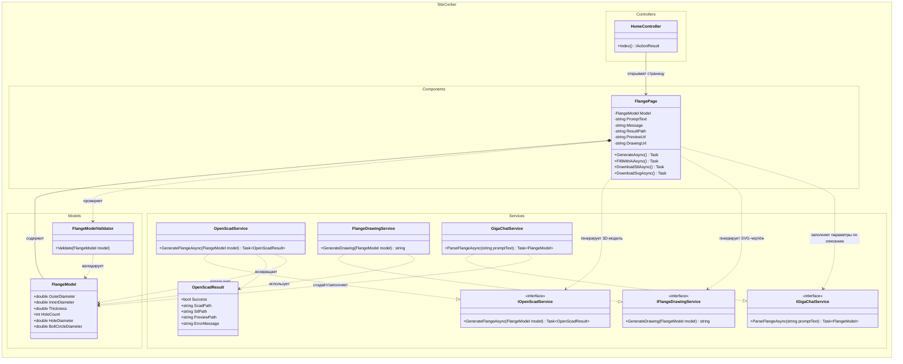

# UML class diagram — SiteCerber

Ниже представлена UML class diagram для модуля `SiteCerber`, который отвечает за параметрическое создание фланца, генерацию 3D-модели, чертежа и заполнение параметров через GigaChat.

